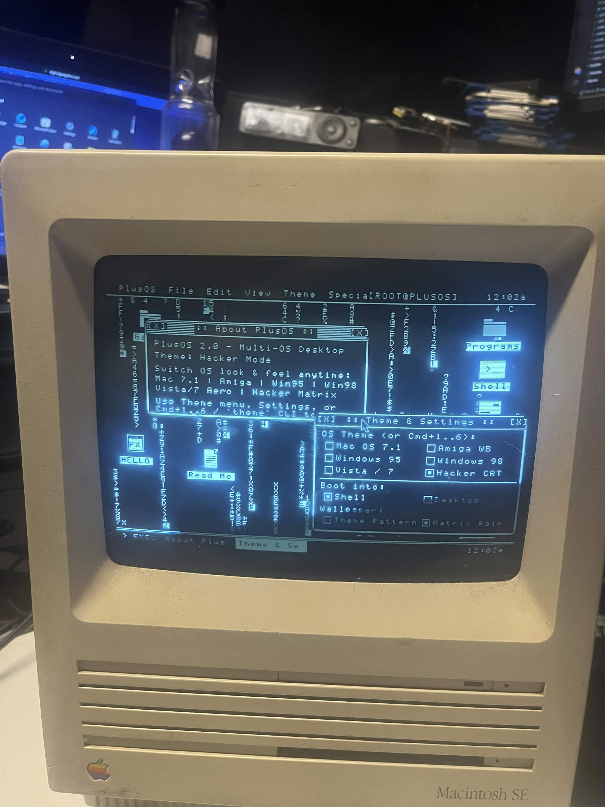
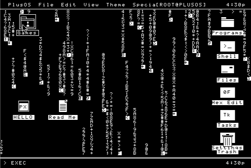
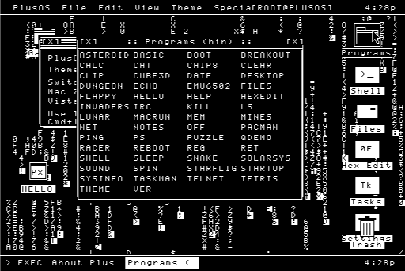
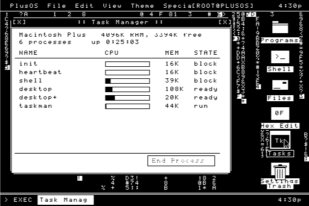
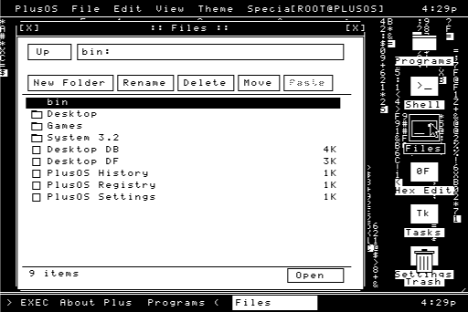
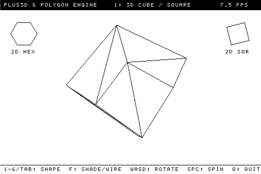
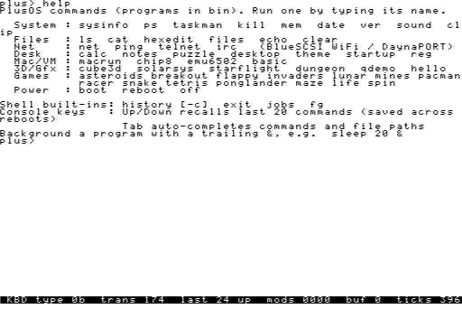

# PlusOS

A bare-metal operating system for the Macintosh Plus and Macintosh SE,
written in C on top of the Mac ROM, plus one SDK per machine.

<p align="center">
  <br>
  <em>PlusOS booted on a real Macintosh SE — the desktop with Matrix wallpaper, the theme switcher, and on-screen icons.</em>
</p>

Source lives on Windows; the m68k cross compiler runs in WSL (Ubuntu).
`build.bat` runs everything from a Windows prompt.

```
build              build both SDK libraries, boot loader, kernel, apps
build install      write it all to the BlueSCSI disk images on the SD card (F:)
build test         install, then boot it in Mini vMac
build sdks         regenerate both SDK folders from the Plus and SE ROMs
build sdktest      run both SDKs' self-tests
build clean
```

## Screenshots

Captured in Mini vMac by `tools/showcase.ps1` (the full set is in
[`docs/screenshots/`](docs/screenshots/)).

| | |
|---|---|
|  |  |
| The desktop: Matrix wallpaper, movable icons, menu bar, themes | The Programs launcher (every command, including `net`/`ping`/`telnet`/`irc`) |
|  |  |
| GUI Task Manager with live CPU bars | The Files explorer |
|  |  |
| Real-time fixed-point 3D (`cube3d`) | Every built-in command, networking included |

Networking (`net`, `ping`, `telnet`, `irc`) needs a real BlueSCSI — Mini vMac
has no DaynaPORT — so the live online session is shown on hardware, not here.

## Layout

| | |
|---|---|
| `sdks/macplus/` | **Macintosh Plus SDK**: standalone library. `<plusrom/...>` headers, `libplusrom.a`. Programs built with it run on the Plus and the SE. |
| `sdks/macse/` | **Macintosh SE SDK**: standalone library. `<serom/...>` headers, `libserom.a`. Adds the SE-only ROM calls (ADB Manager, KeyTranslate, ...). |
| `boot/loader.S` | boot block: loads the kernel from the disk (assembly: it must fit in 1 KB and runs before anything else exists) |
| `kernel/` | the kernel: ROM start-up, console, keyboard, program loader, shell, boot menu. One kernel for both machines. |
| `apps/` | example programs: `hello` (C), `qdemo` (C++ / QuickDraw). An app folder containing a file named `SE` builds with the Mac SE SDK. |
| `tools/sdkgen/` | generates the two SDKs: assembles the Plus and SE ROMs from the mac_rom sources (checked bit-identical to the originals), decodes their trap tables, writes one header + one C file per ROM manager |
| `tools/` | disk installer, Mini vMac test harness |

Each SDK folder is self-contained (ROM layer, C library, PlusOS runtime,
linker script, Makefile, `sdk.mk`, docs, tests) and can be copied anywhere.
Don't edit the generated SDK folders: change `tools/sdkgen` and run `build sdks`.

## Plus vs. SE

| | Mac Plus | Mac SE |
|---|---|---|
| ROM | 128 KB, version $0075 | 256 KB, version $0276 (SE and SE FDHD) |
| Traps / usable calls | 626 / 641 | 660 / 693 |
| Keyboard | Mac Plus keyboard protocol; PlusOS installs the key translator | ADB; PlusOS reads the KeyMap the ROM's ADB driver maintains |
| Toolbox trap table | $0C00 | $0E00 |

The same disk image boots either machine; the kernel detects which one from
the ROM version.

## How it boots

1. The ROM loads the boot blocks of the HFS volume and runs `loader.S`.
2. The loader reads the kernel image (raw blocks reserved in the HFS bitmap),
   places it just below `BufPtr` and jumps to it.
3. The kernel relocates itself, then starts the ROM's subsystems the way the
   ROM's own boot code would: heaps (`SetApplBase`), event queue
   (`InitEvents`), File Manager + boot volume (`InitFS`/`MountVol`) and QuickDraw.
4. Keyboard: on the Plus it installs its own key translation procedure (the
   ROM leaves that to the System file); on the SE it reads the ADB KeyMap.
   Exception handlers make crashes return to the shell.
5. Boot menu, then the shell. Programs are files on the volume: type a name to run it.

## Shell & Console Features

- **Persistent 20-Command History**: Press **Up / Down Arrow** in the console or Desktop terminal window to recall your last 20 commands. Command history is automatically saved to `:PlusOS History` on the hard drive so it persists across reboots. Run `history` to view or `history -c` to clear.
- **Tab Auto-Completion**: Press **Tab** to auto-complete shell built-ins, programs in `:bin:`, and HFS file/folder paths (`:`, `:Desktop:`, `:Games:`, `:bin:`). Repeated **Tab** presses cycle through matching candidates.
- **Built-ins & Commands**: `help`, `history`, `ls`, `cat`, `files`, `hexedit`, `ps`, `taskman`, `kill`, `mem`, `sysinfo`, `date`, `ver`, `reg`, `sound`, `clip`, `calc`, `notes`, `puzzle`, `net`, `ping`, `telnet`, `irc`, `macrun`, `chip8`, `emu6502`, `basic`, `cube3d`, `desktop`, `startup`, `boot`, `reboot`, `off`, or the name of any `.pex` or Classic Mac `'APPL'` program on disk.

## Networking (BlueSCSI WiFi / DaynaPORT)

PlusOS gets on the Internet through a **BlueSCSI V2**'s built-in WiFi, which
emulates a **DaynaPORT SCSI/Link** Ethernet adapter on the SCSI bus. PlusNET
(`<plusnet/net.h>`, `libplusnet`) is a from-scratch TCP/IP stack: a DaynaPORT
SCSI driver, ARP, IPv4, ICMP, UDP, a DHCP client, a DNS resolver, and TCP.

```
net                     bring the adapter up (DHCP by default); show IP, MAC, gateway, DNS
net ip 192.168.1.50 255.255.255.0 192.168.1.1 1.1.1.1   use a static address instead
net id 4                SCSI ID of the DaynaPORT (BlueSCSI's empty NEx.hda)
net stats               frame counters and the last SCSI error
ping google.com         ICMP echo
telnet towel.blinkenlights.nl
irc irc.libera.chat mynick #channel
```

Enable WiFi in `bluescsi.ini` (`WiFiSSID` / `WiFipassword`) and give the card an
empty network device file (e.g. `NE4.hda` at SCSI ID 4). Networking needs the
real hardware — Mini vMac has no DaynaPORT, so `net` there just reports
"no device".

## Highlights

- **Classic Macintosh `'APPL'` Executable Loader (`kernel/macloader.c`, `macrun`)**: Parses HFS Resource Forks, `.rsrc`, and MacBinary `.bin` containers, constructs the Macintosh A5 World and Jump Table from `'CODE'` 0, hooks `_LoadSeg` (`$A9F0`), `_UnLoadSeg` (`$A9F1`), `_GetAppParms` (`$A9F5`), and `_ExitToShell` (`$A9F4`), and runs Classic 68000 Mac applications.
- **Tear-Free Double-Buffered Video & 2D/3D Polygons/Hexagons (`<plusos/gfx.h>`, `<plus3d/plus3d.h>`, `cube3d`)**: Unrolled 64-byte scanline VBL-synced page flipping (`vblit.S`), 16-shade 4x4 ordered Bayer dithering, 2D polygons/N-gons/hexagons (`gfx_poly_fill`, `gfx_poly_dither`, `gfx_ngon_fill`, `gfx_hexagon`), and 3D meshes (`mesh_build_cube`, `mesh_build_hex_prism`, `mesh_build_pyramid`, `mesh_build_octahedron`, `mesh_build_torus`).
- **System 7.1 Features & Desk Accessories**: 22.25 kHz 4-voice PWM hardware sound synthesizer (`sound`), persistent Scrap/Clipboard Manager (`clip`), Calculator (`calc`), Note Pad (`notes`), and 15-Puzzle (`puzzle`).
- **Internet over BlueSCSI WiFi (`<plusnet/net.h>`, `net` / `ping` / `telnet` / `irc`)**: a from-scratch TCP/IP stack — DaynaPORT SCSI/Link driver, ARP, IPv4, ICMP, UDP, DHCP client, DNS resolver and TCP — driving the ROM SCSI Manager (`_SCSIDispatch`) directly. telnet and IRC clients included.
- **Fixed-point 3D engine (`<plus3d/plus3d.h>`, `cube3d`)**: the whole pipeline is 16.16 integer math on the FPU-less 68000 — hardware `MULS.W`/`DIVS.W`, a sine table, and a direct-to-framebuffer rasterizer — so the solid/wireframe models spin in real time.
- **Emulators**: CHIP-8 Arcade VM (`chip8`), MOS 6502 / Apple I Woz Monitor (`emu6502`), and Retro BASIC with polygon/hexagon graphics (`basic`).

See [`docs/MAC_EXEC_AND_RENDERING.md`](docs/MAC_EXEC_AND_RENDERING.md) for the complete technical architecture and documentation.
